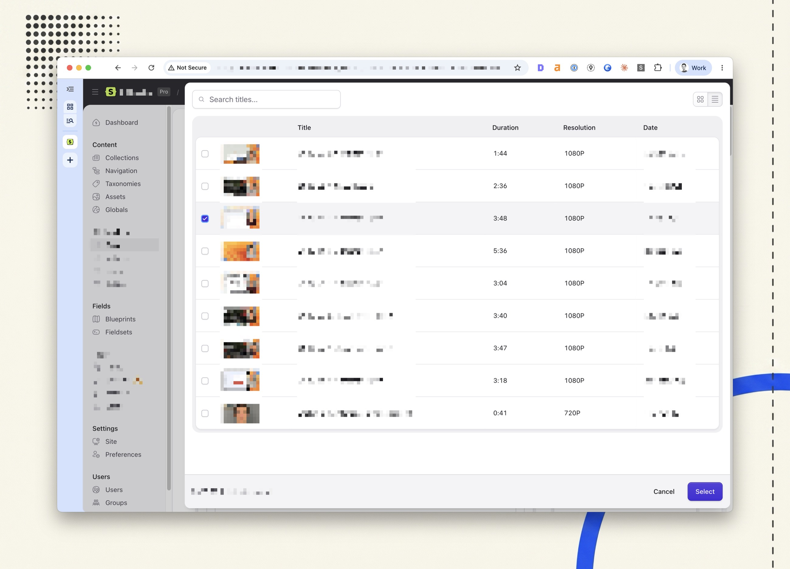

# Popcorn

Upload, choose and play [Mux](https://www.mux.com) videos from a Statamic fieldtype, including videos already in your asset library.

Popcorn adds a **Popcorn Video** field. Editors upload a video from their computer straight to Mux, send one that is already in an asset container, or pick one that is already in the Mux account. The field stores the Mux IDs and a title, and the `{{ popcorn:player }}` tag plays it on the front end with [Video.js](https://videojs.org), the player Mux recommends.

Mux is the only video host for now. The field is built so that others can be added beside it without changing content saved today.




## Requirements

- Statamic 6
- PHP 8.3 or later
- A Mux account and an access token with **Mux Video** set to **Read and Write**

## Installation

```bash
composer require d3creative/statamic-popcorn
```

Create an access token at dashboard.mux.com under **Settings → Access Tokens** and add both halves to `.env`:

```
MUX_TOKEN_ID=your-token-id
MUX_TOKEN_SECRET=your-token-secret
```

The token is only ever read on the server. It is never sent to the browser.

Then add a **Popcorn Video** field to any blueprint or fieldset. It is listed under Media.

## Permissions

Super users can use Popcorn straight away. Everyone else needs **Upload, choose and rename videos with Popcorn** (`use popcorn`). Uploading costs money in Mux and browsing shows every video in the account, so neither comes with being able to edit an entry.

Without the permission, an editor still sees the video already in a field and can change its title and whether the title is shown. They cannot upload, browse, or rename the video in Mux.

To send a video from the asset library, a user also needs to be able to view the container it is in.

## Using the field

| Button | What it does |
|---|---|
| Upload | Asks for a title, then takes a file by drag and drop or file picker and uploads it from the browser straight to Mux. It never passes through your server, so PHP's upload limits do not apply. |
| Choose from Assets | Off by default. Turn on **Allow Choosing from Assets** in the field's settings to show it. Opens Statamic's own asset browser on any container you can view. Choose a video file and your server sends a copy to Mux. The file stays in your library. |
| Browse Mux | Lists the videos in your Mux account that are ready to play, in a grid or a table, with search by title. Double-click a video to choose it straight away. |

Once a video is chosen the field shows it in the player, with:

- **Title**, which is also updated in the Mux dashboard when you leave the box.
- **Show Title**, which draws the title on the player on the front end.
- **Remove**, to clear the field so another video can be chosen. Turn off **Allow Replacing** in the field's settings to hide it. Removing a video from the field does not delete it from Mux.

A new upload is saved into the field as soon as Mux has created it, so the entry can be saved straight away. While Mux is still preparing the video the field says so, and the player starts working when it is ready.

### Sending a video from the asset library

The file is sent from your server to Mux, rather than Mux fetching it from a public URL. That means it works for private containers, for sites Mux cannot reach (a local `.test` domain, a staging site behind a password) and for disks without public URLs.

It runs after the page has had its answer, so no queue worker is needed. A large video can take a few minutes to send; the field shows progress until Mux has it. If the send fails, the field says so.

### Browsing Mux

Mux's API has no search, so Popcorn filters titles itself. When you type a search, any videos not yet loaded are fetched so the whole account is searched, up to the newest thousand or so. Only videos that are ready and have a public playback ID are listed. The grid or table choice is remembered for each user.

## Templates

The field gives you:

| Key | Value |
|---|---|
| `playback_id` | Mux's public playback ID |
| `asset_id` | Mux's asset ID |
| `title` | The title, or null |
| `show_title` | Whether the editor asked for the title to be shown |
| `stream_url` | The HLS stream, `https://stream.mux.com/{playback_id}.m3u8` |
| `thumbnail_url` | A WebP thumbnail from Mux |
| `gif_url` | An animated GIF preview from Mux |
| `provider` | Always `mux` for now |

### With the player tag

Load the player once, in your layout's `<head>`:

```antlers
{{ popcorn:scripts }}
```

Then play a field:

```antlers
{{ popcorn:player :video="hero_video" accent-color="#0061ff" }}
```

Videos play in [Video.js](https://videojs.org) with its Mux media element, which is what Mux recommends now that [Mux Player is in maintenance mode](https://www.mux.com/docs/guides/player-faqs). The tag draws three elements: `<video-player>` holds the player's state, `<video-skin>` draws the controls, and `<mux-video>` plays the stream from Mux, with a poster and timeline previews made from the playback ID.

Each parameter goes to the element it belongs to:

| Parameter | Goes to |
|---|---|
| `style`, `class` | `<video-skin>`, which is the box you see |
| `accent-color` | The skin's `--media-accent-color` |
| `tracking`, `cookies` | Whether Mux Data is on for this player. See [Privacy](#privacy) |
| `metadata-*` | Mux Data, when tracking is on |
| Anything else | `<mux-video>`: `autoplay`, `muted`, `loop`, `poster-time` and the rest of the [Video.js media attributes](https://videojs.org/docs/framework/html/guides/migrate-from-mux-player/) |

A parameter set to `true` becomes a bare attribute (`muted="true"` gives `muted`); `false` leaves it out. The title is drawn on the player, as its `content-title`, only when **Show Title** is on. Otherwise `content-title` is set to an empty string, because without it Video.js shows the title Mux has for the video.

The skin is given `display: block`, ahead of any `style` you pass, as in Mux's own example. That makes it fill its box without a small gap below it, so in a box with rounded corners the bottom corners are drawn on the video. Set `display` in your own `style` to change it.

`{{ popcorn:scripts }}` serves the player from your own site. Video.js is built into the add-on and published with it to `public/vendor/statamic-popcorn`, so visitors' browsers fetch it from your domain and contact no one but Mux. Put the tag in the `<head>` of any layout that plays video. It loads Mux Data's code only when tracking is on.

If you would rather include the player in your site's own JavaScript, so that pages without a video don't load it at all, leave `{{ popcorn:scripts }}` out and bundle it yourself:

```bash
npm install @videojs/html@10.5.0 @videojs/mux-video@10.5.0
```

```js
// site.js
// [data-video] covers a click-to-play wrapper (see Privacy), which has no
// player on the page until it is pressed.
if (document.querySelector('video-player, mux-video, [data-video]')) {
    import('./video-player.js');
}
```

```js
// video-player.js
import '@videojs/html/video/player';
import '@videojs/html/video/skin';
import '@videojs/html/media/mux-video';

// Only if you turn tracking on (npm install @videojs/mux-data@10.5.0 too).
if (document.querySelector('mux-data')) {
    import('@videojs/html/extensions/mux-data');
}
```

To load Video.js from a public CDN instead, set `POPCORN_PLAYER_CDN` to an [`@videojs/cdn`](https://www.npmjs.com/package/@videojs/cdn) release, such as `https://cdn.jsdelivr.net/npm/@videojs/cdn@10.5.0`, with an exact version, because the files in a release import each other's shared chunks. There is little reason to: browsers no longer share cached files between sites, so a CDN copy saves your visitors nothing, and the CDN is a third party that sees every visitor's IP address with no agreement with you.

Mux Player and Video.js both define a `<mux-video>` element, and a page can only have one, so don't load Mux Player on the same pages.

### Writing the element yourself

```antlers
{{ hero_video }}
    <video-player content-title="{{ if show_title }}{{ title }}{{ /if }}">
        <video-skin style="display: block; aspect-ratio: 16 / 9;">
            <mux-video src="{{ stream_url }}" playsinline crossorigin="anonymous"></mux-video>
        </video-skin>
    </video-player>
{{ /hero_video }}
```

### GraphQL

The field is a `PopcornVideo` type with the same keys.

## Privacy

> **This section is general information, not legal advice.** It describes how Popcorn and Mux behave, as checked against Mux's documentation, its data processing addendum (updated 12 October 2026) and the code Popcorn ships, on 18 November 2026. Privacy law differs between countries and US states and changes often, and Mux can change its services and terms. Whether a site complies depends on everything else it does, not only on Popcorn. You, as the site owner, are responsible for your own compliance: have your privacy policy, cookie banner and settings reviewed by a qualified lawyer, especially if your organisation has faced privacy claims before. Popcorn is provided "as is" under the [MIT licence](LICENSE), without warranty of any kind, and D3 Creative accepts no liability for how it is configured or used.

**Popcorn turns tracking and cookies off by default.** Out of the box, `{{ popcorn:player }}` plays videos without Mux Data, Mux's analytics service: nothing is reported about what visitors watch, no cookie is set, and Mux Data's code isn't even loaded. Previews in the Control Panel are never tracked either.

Even then, the video and its poster are delivered from Mux's servers (`stream.mux.com`, `image.mux.com` and Mux's delivery network), which see the viewer's IP address and browser as any server does. Mux does this as your processor under its [data processing addendum](https://www.mux.com/dpa). The player itself comes from your own site, so no other third party is involved, unless you set `POPCORN_PLAYER_CDN`.

### Contacting Mux only when someone presses play

Out of the box the player contacts Mux as soon as the page loads, so that playback can start straight away. Two settings cut that down, but neither stops it:

- `preload="none"` stops the video itself downloading before play. Video.js still fetches the video's details, its playlist and the timeline thumbnails from Mux when the page loads.
- Your own poster, from your asset library rather than Mux, stops the poster request to `image.mux.com`. Put it in the skin's `poster` slot when you write the elements yourself: `` inside `<video-skin>`.

```antlers
{{ popcorn:player :video="hero_video" preload="none" }}
```

To send Mux nothing at all until a visitor presses play, don't put the player on the page until then. Show your own poster image and a play button, and swap in the player when it is pressed:

```antlers
{{ if hero_video }}
<div data-video x-data="{ playing: false }" style="aspect-ratio: 16 / 9;">
    <button x-show="! playing" @click="playing = true"
            type="button" aria-label="Play {{ hero_video:title }}" style="display: block; width: 100%; height: 100%;">
        
    </button>
    <template x-if="playing">
        {{ popcorn:player :video="hero_video" autoplay="true" style="width: 100%; height: 100%;" }}
    </template>
</div>
{{ /if }}
```

This example uses Alpine.js, but any script that adds the player's markup after a click does the same. Video.js still has to be loaded on the page: `{{ popcorn:scripts }}` does that, and the [bundled loader above](#with-the-player-tag) looks for `data-video` so that it loads Video.js for a player that isn't on the page yet. The video starts with sound, because the visitor has just pressed play.

### Turning tracking on

Mux Data gives you view counts, watch time and playback quality in the Mux dashboard. To turn it on for the whole site, add to `.env`:

```
POPCORN_TRACKING=true
```

With tracking on, every view is reported to [Mux Data](https://www.mux.com/docs/guides/ensure-data-privacy-compliance): what was watched and for how long, playback quality and errors, and the viewer's device, operating system and browser. Views are reported against the field's title and Mux asset ID. Mux uses the viewer's IP address to estimate their country and region and to filter out bots, then truncates it before storing it, and keeps view data for up to 100 days.

Tracking stays cookieless unless you also add:

```
POPCORN_TRACKING_COOKIES=true
```

That lets Mux Data set a first-party cookie called `muxData`, holding a random viewer ID and session details, which lasts up to a year, so returning viewers can be told apart from new ones.

In the UK and EU, analytics like this usually need the visitor's consent. A template can turn tracking on or off for one player, so you can leave it off in `.env` and turn it on once a visitor has agreed, passing whatever your consent setup gives you:

```antlers
{{ popcorn:scripts :tracking="analytics_consent" }}

{{ popcorn:player :video="hero_video" :tracking="analytics_consent" }}
```

`popcorn:scripts` needs the same parameter, because it only loads Mux Data's code when tracking is on. These settings only reach players drawn by `{{ popcorn:player }}`; if you write the elements yourself, add `<mux-data>` inside `<video-skin>` to track.

### Wording for your privacy policy

Copy the paragraph that matches your settings, then adjust it to your site. These are starting points, not finished legal text: they describe only Popcorn and Mux, and your policy also has to cover everything else your site does. Have the result checked by a lawyer before you publish it (see the [note above](#privacy)). Mux's own position is in its [privacy policy](https://www.mux.com/privacy) and [data processing addendum](https://www.mux.com/dpa) ([PDF](https://www.mux.com/files/mux-dpa.pdf)). The addendum names Mux as your processor for the IP addresses, browser details and approximate location of people watching your videos, whether or not Mux Data is on, so the transfer sentence belongs in both versions.

**With tracking and cookies off** (the default):

> Videos on this website are hosted by Mux, Inc., a video platform based in the United States. When you watch a video, your browser loads it and its preview image from Mux's servers, which receive your IP address and information about your browser and device in order to deliver it. Mux processes this information on our behalf and may transfer it to the United States, under the EU–US Data Privacy Framework and its UK Extension, or standard contractual clauses where those do not apply. We do not use Mux's viewing statistics, so Mux does not collect analytics about what you watch for us, and the video player sets no cookies. You can read more in Mux's privacy policy at https://www.mux.com/privacy.

**With tracking and cookies on** (`POPCORN_TRACKING=true` and `POPCORN_TRACKING_COOKIES=true`):

> Videos on this website are hosted by Mux, Inc., a video platform based in the United States. When you watch a video, your browser loads it from Mux's servers, which receive your IP address and information about your browser and device. Mux also collects viewing statistics for us through its Mux Data service: which video you watched, how much of it you played, the playback quality and any errors, and your device type, operating system and browser. Mux uses your IP address to estimate your country and region and to filter out automated traffic, then shortens it before storing it; it does not collect your name or email address. To recognise repeat views, Mux sets a cookie on this website called `muxData`, which holds a random viewer ID and session details and lasts for up to a year. Mux keeps viewing statistics for up to 100 days. Mux processes this data on our behalf and may transfer it to the United States, under the EU–US Data Privacy Framework and its UK Extension, or standard contractual clauses where those do not apply. You can read more in Mux's privacy policy at https://www.mux.com/privacy.

If you turn tracking on but leave cookies off, use the second paragraph without the sentence about the `muxData` cookie. If you set `POPCORN_PLAYER_CDN`, add to either: "The video player itself is loaded from jsDelivr, a public content delivery network, which receives your IP address and browser information." (naming your CDN).

### In the United States

The US has no cookie-consent law like the UK's and EU's. The risk is litigation: suits under California's Invasion of Privacy Act (CIPA), the federal Video Privacy Protection Act (VPPA) and the California Consumer Privacy Act (CCPA) have targeted sites whose third-party scripts collect data from visitors. This is how Popcorn stands against each with its defaults, and what would change that. It is an outline of the issues to raise with your counsel, not legal advice and not a guarantee that a site cannot be sued; see the [note above](#privacy). Case law in this area is unsettled and moves quickly.

- **CIPA "wiretap" and "pen register" claims** argue that a third party received visitors' data, such as their IP address, without consent. With tracking off and the player served from your site, the only outside party a visitor's browser contacts is Mux, and only to deliver the video. Mux's data processing addendum (section 11) makes Mux your CCPA "service provider": it may not sell or share the data, use it for anything else, or combine it with other data. Turning tracking on adds analytics, which is what these suits are about, and setting `POPCORN_PLAYER_CDN` adds a third party with no such agreement. For the strongest position, use [click-to-play](#contacting-mux-only-when-someone-presses-play), so that nothing is sent to anyone until a visitor chooses to watch.
- **VPPA claims** are about passing "this person watched this video" to someone who can identify them, usually an advertising pixel such as Meta's. Popcorn never sends anything that identifies a viewer. Even with tracking on, Mux Data receives the video's title and ID with a random viewer ID, or none unless cookies are on. Never add `metadata-viewer-user-id` with a name, email or account ID. The larger VPPA risk on any site is an advertising pixel on pages that play video, which Popcorn has nothing to do with.
- **CCPA and CPRA.** Passing data to a service provider is not a "sale" or "share", so Popcorn needs no "Do Not Sell or Share" or Global Privacy Control handling. Your privacy policy should still say that video is hosted by Mux; the paragraph for tracking off covers it.

For a site that is sensitive to this, and subject to your counsel's advice, keep the defaults (tracking and cookies off, no CDN), consider click-to-play, confirm that Mux's data processing addendum applies to your Mux account, and add the paragraph for tracking off to your privacy policy.

## Configuration

Publish the config to change the defaults:

```bash
php artisan vendor:publish --tag=statamic-popcorn-config
```

| Setting | Default | What it does |
|---|---|---|
| `mux.token_id`, `mux.token_secret` | `MUX_TOKEN_ID`, `MUX_TOKEN_SECRET` | Your Mux access token |
| `mux.video_quality` | `POPCORN_MUX_VIDEO_QUALITY`, or your Mux account's default | `basic`, `plus` or `premium` for videos Popcorn creates. It changes what Mux charges, so check Mux's pricing first |
| `mux.per_page` | `50` | How many videos Browse Mux asks for at a time (Mux allows up to 100) |
| `player.cdn` | `POPCORN_PLAYER_CDN`, or `null` | An `@videojs/cdn` release to load Video.js from instead of your own site. Best left `null`. See [With the player tag](#with-the-player-tag) |
| `player.tracking` | `POPCORN_TRACKING`, or `false` | Report views to Mux Data from every `{{ popcorn:player }}`. See [Privacy](#privacy) |
| `player.cookies` | `POPCORN_TRACKING_COOKIES`, or `false` | Let Mux Data set its `muxData` cookie when tracking is on. See [Privacy](#privacy) |
| `poll_interval` | `3000` | Milliseconds between status checks while Mux receives or prepares a video |

## When Mux refuses

If Mux refuses an upload, the field shows Mux's own reason and puts the drop zone back, so nothing is left half-done. A refusal that mentions a limit or the plan, such as the 10-video cap on Mux's free plan, also says how to deal with it: upgrade the plan or delete videos you no longer need at dashboard.mux.com. Mux checks its limits before any of the file is sent, or once the file has arrived, and the field reports either. A video already in a field keeps playing.

## What Popcorn does not do

- **Signed playback.** Videos are created with a public playback policy, and videos with only signed playback IDs are not listed.
- **Delete videos in Mux.** Removing a video from a field leaves it in your Mux account. Delete it in the Mux dashboard if you no longer need it.
- **Live streams.** Popcorn handles on-demand videos only.

## Support

Report bugs and request features on [GitHub](https://github.com/d3creativeuk/statamic-popcorn/issues).

## Licence

MIT. See [LICENSE](LICENSE). The compiled player and uploader include open-source packages under the MIT, Apache 2.0 and BSD licences; their licences and notices are in [THIRD-PARTY-NOTICES.md](THIRD-PARTY-NOTICES.md).

Popcorn is not made by, affiliated with or endorsed by Mux, Inc. or the Video.js project. Mux is a trademark of Mux, Inc., and Video.js is a registered trademark of Brightcove Inc.
